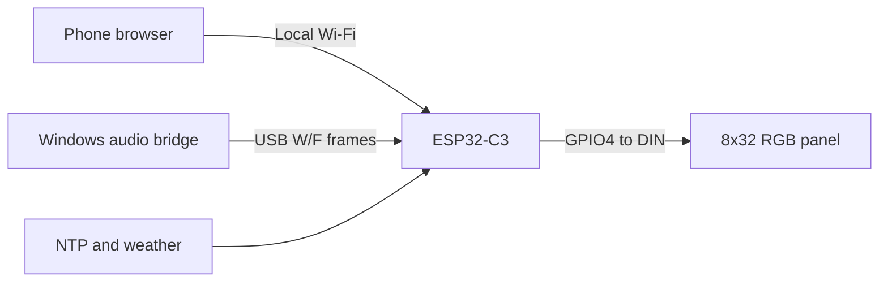

<div align="center">

# 桌面灯板 · Desktop LED Panel

**把一块 8×32 灯板变成时钟、中文便签、像素宠物和音乐可视化屏。**<br>
An ESP32-C3 desktop display for clocks, Chinese phrases, pixel pets and audio visualizations.


[下载 1.0.0 / Download](https://github.com/QQ-L-XX/esp32-desktop-led-panel/releases/tag/v1.0.0) · [刷写说明 / Flashing](docs/FLASHING.md)


*中文点阵渲染预览，非实物照片。Rendered pixel preview, not a photograph.*

</div>

## 1.0 能做什么 / Features

| 模式 / Mode | 功能 / Behavior |
|---|---|
| 日历时钟 / Clock | 同屏时间、日期、福州天气和温度；联网后自动校时。Time, date and Fuzhou weather with network time sync. |
| 中文语句 / Phrases | 四字整句显示，长句滚动；默认每句 10 秒；网页编辑、收藏、替换和追加。Editable playlists and favorites with scrolling for longer lines. |
| 小鸭 / Duck | 像素鸭子、摸摸和玩水互动。Animated pixel duck with interactions. |
| 彩色波形 / Waveform | 平滑彩色波形；静音时为中线跑马灯。Smoothed waveform with an idle color chase. |
| 频谱柱 / Spectrum | 16 段频谱与峰值；静音时环绕追光。16-band spectrum and perimeter chase when silent. |
| 其他 / Extras | 照明、新年动画、小恐龙及电脑状态。Lamp, New Year animation, dinosaur game and PC status. |

亮度、模式、轮播词句和收藏保存在设备中。时钟、文字和动画可脱离电脑运行；**音乐律动需要 Windows 电脑后台通过 USB 提供声音数据**。1.0 没有麦克风。

Brightness, mode, phrases and favorites are stored on the device. Standalone modes do not require a PC. **Audio modes require the Windows USB audio bridge**; this release has no microphone.

## 硬件 / Hardware

- ESP32-C3，4 MB Flash；使用原生 USB Serial/JTAG 的已验证开发板。ESP32-C3 with 4 MB flash and native USB Serial/JTAG.
- 一块 8×32、256 颗三线 5V RGB 灯板；GPIO4 接 DIN。One 256-pixel panel, GPIO4 to DIN.
- 当前映射为列蛇形并双轴翻转，可能需要根据自己的灯板修改 `setStripPixel()`。The column-serpentine, 180-degree mapping is panel-specific.
- 控制器和灯板共地；供电按实际灯珠和亮度预算选择。Share ground and size the supply for your actual panel.



这份 1.0 只支持一块屏。四屏、麦克风和传感器属于后续 2.0，尚未实现。GPIO 不给灯板供电；不要将灯板数据线接到 OUT。

Version 1.0 targets one panel. Four-panel layouts, microphones and sensors are future work. GPIO is a data signal, not a power source; connect to DIN.

## 固件编译与首次启动 / Firmware setup

安装 [PlatformIO](https://platformio.org/install)，然后执行 / Install PlatformIO, then build:

```powershell
pio run -d firmware-source
```

刷写前确认串口、芯片和 MAC 是目标设备，关闭占用该串口的后台程序。`COMx` 必须替换为实际串口。

Verify the target port, chip and MAC before uploading; stop any serial audio bridge first. Replace `COMx` with your actual port.

```powershell
pio run -d firmware-source -t upload --upload-port COMx
pio device monitor --port COMx --baud 115200
```

打开监视器后按主控复位键。热点名称为 `LED-Clock-XXXX`。**公开版首次启动生成独立的 16 位热点密码，并保存在设备中**；在串口的 `Panel setup: AP password:` 行读取。后续启动会显示同一个密码。不要公开分享这段串口日志。

With the monitor open, press RESET. The access point is named `LED-Clock-XXXX`. **The public build generates and persists a unique 16-character AP password**; read it from `Panel setup: AP password:` in the local serial console. Do not share logs containing it.

手机连接热点后打开 `http://192.168.4.1/`。在网页填入自己的 2.4 GHz Wi-Fi，设备联网后自动校时和更新天气。同一局域网也可以通过设备显示的局域网地址访问。

Connect your phone to the AP and open `http://192.168.4.1/`. Configure a 2.4 GHz home network for time and weather updates. The page also shows the device's LAN address.

首次未校时显示小鸭；彻底断电后的时间恢复依赖联网校时，1.0 不含带电池的 RTC。天气固定为福州，失败时保留可用缓存并重试。

Before time is available, the duck is shown. Time recovery after complete power loss relies on networking; no battery-backed RTC is included. Weather is fixed to Fuzhou and uses caching and retries.

## Windows 音乐后台 / Windows audio bridge

需要 Python 3.11 和 Windows WASAPI 播放设备。采集电脑正在播放的声音，不采集麦克风。

Requires Python 3.11, Windows and a WASAPI playback device. It captures playback audio, not microphone input.

```powershell
py -3 -m pip install -r desktop/requirements.txt
Copy-Item desktop/panel.example.json desktop/panel.local.json
```

将 `desktop/panel.local.json` 的 `mac` 改为自己的 ESP32-C3 MAC。也可设置环境变量 `LED_PANEL_MAC`；支持带冒号或不带冒号的格式。程序只匹配明确配置的原生 USB ESP32-C3，不自动接管其他串口设备。

Set `mac` in the ignored `desktop/panel.local.json` to your own controller, or set `LED_PANEL_MAC`. The bridge only selects an explicitly configured native USB ESP32-C3.

```powershell
# 打开桌面窗口 / Open desktop controls
py -3 desktop/音乐律动.pyw

# 无窗口后台 / Headless bridge
pythonw desktop/音乐律动.pyw --background

# 停止后台 / Stop the bridge
py -3 desktop/音乐律动.pyw --stop-background
```

后台连接后，在手机网页直接选择“彩色波形”或“频谱柱”。仅在这两种模式采音，离开模式后释放采集。桌面窗口与后台自动交接串口。

Once connected, choose Waveform or Spectrum in the phone browser. Capture is active only in audio modes. Desktop controls and the background process hand off serial ownership.

如需登录自启动，可在 Windows 的 `shell:startup` 文件夹创建指向 `pythonw`、此脚本绝对路径和 `--background` 参数的快捷方式。仓库不会自动修改启动项。

For login autostart, create a shortcut in Windows `shell:startup` pointing to `pythonw`, the absolute script path and `--background`. This repository does not install startup entries automatically.

## 中文轮播 / Chinese playlists

默认内容 / Default playlist:

```text
物来顺应
未来不迎
当时不杂
既往不恋
```

网页一行一句，点击“保存并播放”；每句可设 3–120 秒。最多 16 句，每句最多 32 个字符；四个汉字整句显示，长句横向滚动。常用词句最多收藏 32 条，可去重、删除、替换或追加到编辑框。字库不支持的生僻字和表情会明确提示。

Enter one phrase per line and save. Timing is 3–120 seconds per phrase, with up to 16 phrases of 32 characters each and 32 favorites. Four Chinese characters fit at once; longer lines scroll. Unsupported characters and emoji are rejected with a clear error.

<details>
<summary>查看实际网页截图 / Actual web editor screenshot</summary>


</details>

## 目录 / Repository layout

```text
firmware-source/   PlatformIO firmware and retained font licenses
desktop/           Windows GUI and headless WASAPI bridge
font-tools/        Font source and reproducible subset generator
checks/            Manual hardware checks and baseline evidence
docs/              Validation scope, notices and screenshots
```

## 验证与边界 / Validation

本地硬件基线已检查 USB 目标、刷写校验、网页编辑、错误输入拒绝、收藏去重、软件重启后恢复和一整轮轮播。电脑音频后台曾通过真实测试音、前后台交接和重复启动检查。

The local hardware baseline was checked for target identity, flashing, web editing, invalid inputs, favorites, software-reboot persistence and one complete phrase cycle. The desktop bridge was tested with real playback tones and process handoff.

**公开版新增随机热点密码和可配置 MAC，经过编译及离线检查；没有为了发布而重刷原设备。历史实机记录不能当作这些改动已完成实机验收。** 计时记录带有网页取样延迟；软件复位不等于物理断电；8 行汉字的实际可读性需观察实物。

**The public release adds per-device AP passwords and configurable controller identity. These changes are build/offline checked, not flashed to the original panel as part of publication.** Historical hardware evidence does not prove those new paths. HTTP sampling latency, physical cold-power recovery and real pixel readability have distinct validation limits.

详见 [验证说明 / Validation notes](docs/VALIDATION.md)。`checks/` 会操作真实灯板和播放测试音，不能当作无需硬件的单元测试直接运行。

See [validation notes](docs/VALIDATION.md). The manual checks control real hardware and may play audio; they are not unattended unit tests.

## 本地网络与隐私 / Local network and privacy

未包含家中 Wi-Fi 密码、原设备 MAC、电脑私人路径或 NVS 转储。`panel.local.json`、运行日志和测试目标配置被忽略。控制网页用于可信局域网，没有 HTTP 用户认证，请勿转发到公网。天气由第三方服务提供；联网时设备会请求该服务和 NTP。

No personal Wi-Fi credentials, original device MAC, private workstation paths or NVS dumps are included. Local configuration and runtime files are ignored. The HTTP UI is intended for trusted local networks and has no user authentication; do not expose it to the Internet. Weather and time use third-party network services.

## 版本与授权 / Version and licensing

[1.0.0 更新记录 / Changelog](CHANGELOG.md) · [第三方说明 / Third-party notices](docs/THIRD_PARTY_NOTICES.md)

原创项目代码暂未指定开源许可证；公开仓库用于查看和评估。字体及依赖保留各自上游授权，不受此声明替代。

No open-source license has yet been assigned to the original project code. This is a public source repository for inspection and evaluation. Fonts and dependencies retain their respective upstream licenses.
